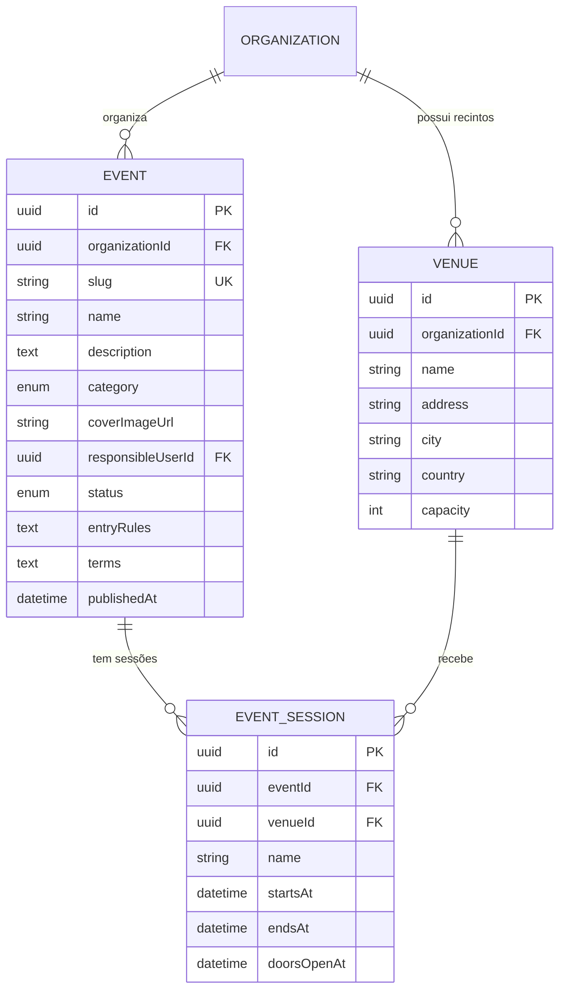

# Domínio 2 — Gestão de Eventos e Sessões

Responsável pela criação, configuração, publicação e encerramento de eventos.

## MER — Domínio 2

## Estados do evento (ciclo de vida)

| Estado | Significado | Transição permitida |
|---|---|---|
| DRAFT | Em preparação | → PUBLISHED, CANCELLED |
| PUBLISHED | Publicado e à venda | → SUSPENDED, SOLD_OUT, POSTPONED, CANCELLED |
| SUSPENDED | Venda pausada | → PUBLISHED, CANCELLED |
| SOLD_OUT | Inventário esgotado (automático) | → PUBLISHED (se inventário libertado) |
| POSTPONED | Adiado, aguarda nova data | → PUBLISHED, CANCELLED |
| CANCELLED | Cancelado | terminal |
| COMPLETED | Todas as sessões realizadas | terminal |
| CLOSED | Encerrado administrativamente | terminal |

## Regras de negócio aplicadas (conforme documentação mestra)

1. O sistema distingue claramente **evento**, **sessões** e **bilhetes** associados.
2. Suporte a eventos de data única e eventos com múltiplas datas/sessões (via `EventSession`).
3. `slug` único por organização (`@@unique([organizationId, slug])`).
4. Cancelamento/adiamento **não apaga** obrigações financeiras (partes 5+).
5. Toda a alteração de estado do evento é registada no `AuditLog`.
6. Isolamento multiempresa: todas as consultas obrigatóriamente filtradas por `organizationId`.

## Permissões do domínio (a seeded na Parte 4)

| Código | Descrição |
|---|---|
| `event:create` | Criar evento |
| `event:read` | Consultar eventos |
| `event:update` | Editar evento |
| `event:publish` | Publicar/suspender evento |
| `event:cancel` | Cancelar/postergar evento |
| `venue:manage` | Gerir recintos |
| `session:manage` | Gerir sessões |
