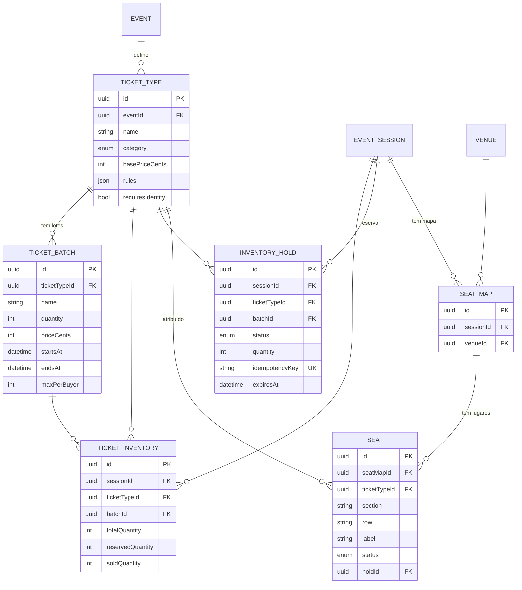

# Domínio 3 — Bilhetes e Inventário

Tipos de bilhetes, lotes, lugares numerados e o núcleo comum de inventário
(disponibilidade, reservas temporárias, exclusividade, expiração e proteção
contra venda duplicada).

## MER — Domínio 3

## Estados da reserva temporária (HoldStatus)

Conforme documentação mestra, secção 11:

| Estado | Significado |
|---|---|
| RESERVED | Reserva temporária ativa, inventário protegido |
| PENDING_PAYMENT | Pagamento iniciado, aguarda confirmação |
| VERIFYING | Pagamento sem resultado definitivo — inventário permanece protegido |
| CONFIRMED | Venda confirmada, hold consumido em soldQuantity |
| EXPIRED | Prazo terminou, inventário libertado |
| CANCELLED | Cancelado pelo utilizador ou pelo sistema |

Regra crítica: **se existir transação financeira sem resultado definitivo, o
inventário permanece protegido** (hold não expira enquanto estado = VERIFYING).

## Categorias de bilhete

| Categoria | Observação |
|---|---|
| NORMAL | Preço base |
| VIP | Regras próprias |
| PREMIUM | Regras próprias |
| STUDENT | Documento exigível |
| CHILD | Condições de idade |
| FREE | Gratuito — emissão ainda exige titular |
| INVITE | Convite — pode exigir aprovação |
| SPECIAL_ACCESS | Acesso especial |

## Regras do núcleo de inventário

1. Disponibilidade calculada em **transação**:
   `available = totalQuantity - reservedQuantity - soldQuantity`.
2. Reservas temporárias com **prazo controlado pelo servidor**; o navegador
   nunca é fonte confiável de valores ou prazos.
3. `idempotencyKey` único em `InventoryHold` impede reservas duplicadas.
4. Exclusividade de venda de lugares: `Seat.status` transita
   AVAILABLE → RESERVED → SOLD; a transição é atômica com atualização de
   `TicketInventory`.
5. Varrimento de expiração por índice `expiresAt` (job periódico).
6. Limite por comprador aplicado no servidor (`maxPerBuyer`).
7. Isolamento multiempresa: `organizationId` em `InventoryHold` e consultas.

## Permissões do domínio

| Código | Descrição |
|---|---|
| `ticketType:manage` | Criar/editar tipos de bilhete |
| `batch:manage` | Criar/editar/encerrar lotes |
| `seats:manage` | Gerir mapas e lugares |
| `seats:block` | Bloquear/desbloquear lugares |
| `inventory:read` | Consultar disponibilidade |
| `inventory:hold` | Criar reservas (checkout) |
