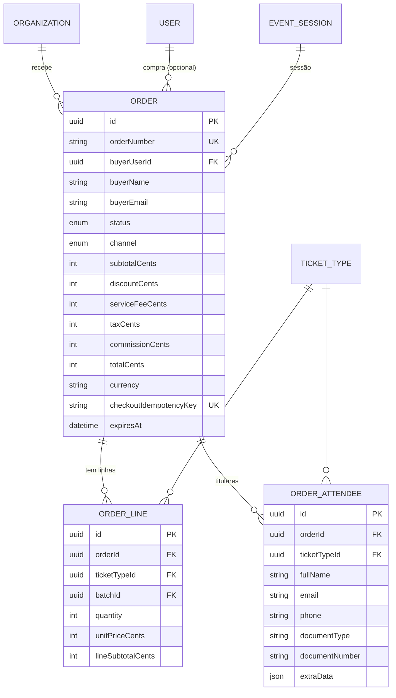

# Domínio 4 — Venda e Checkout

O checkout é o processo central de conversão de uma intenção de compra numa
encomenda, pagamento confirmado e emissão dos bilhetes. Funciona no marketplace
público, área privada do organizador, bilheteira física e canais futuros —
todos utilizando o mesmo motor de inventário e encomendas.

## Fluxo do checkout (13 passos, doc. mestra)

1. Seleção do evento, sessão e tipo de bilhete.
2. Seleção da quantidade ou dos lugares disponíveis.
3. Verificação da disponibilidade.
4. Reserva temporária do inventário.
5. Identificação do comprador.
6. Identificação obrigatória de cada titular.
7. Aplicação de descontos e taxas.
8. Apresentação do resumo financeiro.
9. Seleção do método de pagamento.
10. Processamento e confirmação do pagamento.
11. Emissão dos bilhetes.
12. Envio de comprovativo e notificações.
13. Registo da operação no histórico financeiro.

## MER — Domínio 4



## Estados da encomenda (OrderStatus)

| Estado | Significado |
|---|---|
| DRAFT | Compra ainda não concluída |
| RESERVED | Inventário temporariamente protegido |
| PENDING_PAYMENT | Aguarda confirmação do pagamento |
| UNDER_REVIEW | Existe uma ocorrência financeira |
| CONFIRMED | Venda validada |
| PARTIALLY_REFUNDED | Parte do valor foi devolvida |
| REFUNDED | Valor integralmente devolvido |
| CANCELLED | Operação cancelada |
| EXPIRED | Prazo da reserva terminou |
| DISPUTED | Existe contestação financeira |

## Regras críticas (doc. mestra + segurança)

1. **O servidor calcula e valida** preço unitário, quantidade, descontos,
   taxas de serviço, impostos, comissões, total e moeda. O navegador **nunca**
   é considerado fonte confiável de valores financeiros (SEC).
2. `checkoutIdempotencyKey` único: uma intenção de compra não gera
   encomendas duplicadas.
3. **Identificação obrigatória de cada titular** (secção 12): comprador é a
   pessoa responsável pela encomenda e pagamento; titular é o participante
   com direito de entrada. Não é obrigatório criar conta para cada titular.
   O comprador pode ser titular de um dos bilhetes.
4. `buyerUserId` opcional: no marketplace, compra sem conta é possível;
   os dados mínimos do comprador (nome, email) são sempre exigidos.
5. Encomendas mono-sessão no MVP (`sessionId` na encomenda); multi-sessão
   fica para fase posterior.
6. Cada venda regista a sua origem (`SalesChannel`): marketplace, ambiente
   privado do organizador, bilheteira física ou origens futuras autorizadas.
7. Valores monetários em **cêntimos** (Int) — nunca floats.

## Cálculo financeiro (responsabilidade do servidor)

```
subtotalCents   = Σ(lineSubtotalCents)
lineSubtotal    = quantity × unitPriceCents (preço do lote, fallback base)
totalCents      = subtotal − discount + serviceFee + tax
commissionCents = comissão da plataforma conforme contrato/mercado
```

## Permissões do domínio

| Código | Descrição |
|---|---|
| `order:create` | Iniciar checkout |
| `order:read` | Consultar encomendas (próprias ou da organização) |
| `order:cancel` | Cancelar encomenda |
| `order:review` | Analisar ocorrências (UNDER_REVIEW) |
| `order:refund` | Aprovar reembolso (domínio 5) |
