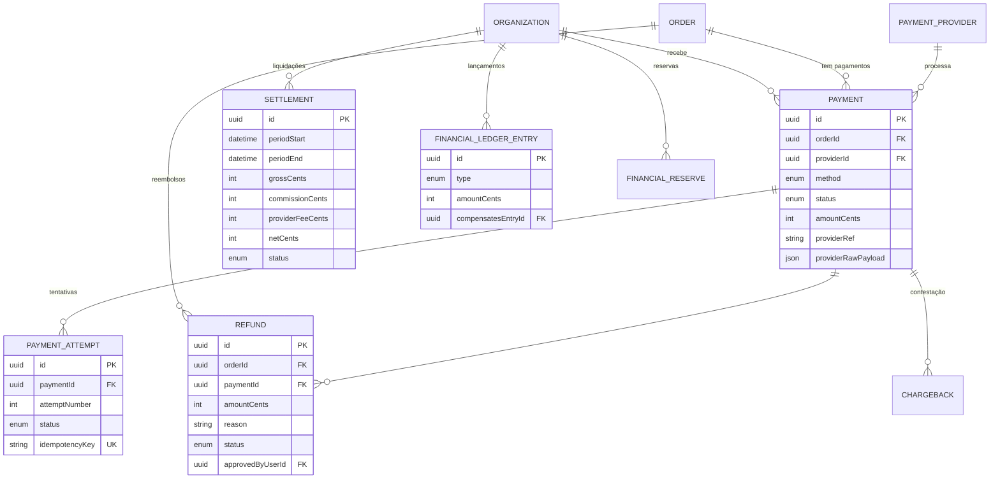

# Domínio 5 — Pagamentos e Finanças

Integração com prestadores de pagamento, tentativas controladas, reembolsos,
chargebacks, liquidações, reservas financeiras e livro-razão imutável.

## MER — Domínio 5



## Estados do pagamento (PaymentStatus)

| Estado | Significado |
|---|---|
| CREATED | Criado, ainda não iniciado |
| INITIATED | Iniciado no prestador |
| AWAITING_AUTHORIZATION | Aguarda autorização (ex: confirmação Mobile Money) |
| PROCESSING | Em processamento |
| CONFIRMED | Confirmado — única fonte de emissão de bilhetes |
| DECLINED | Recusado pelo prestador |
| CANCELLED | Cancelado |
| EXPIRED | Expirado |
| UNDER_REVIEW | Em análise (ocorrência financeira) |
| REFUNDED | Integralmente reembolsado |
| PARTIALLY_REFUNDED | Parcialmente reembolsado |
| DISPUTED | Em disputa |

## Decisões aprovadas implementadas

| Decisão | Implementação |
|---|---|
| Opção B — novas tentativas controladas | `PaymentAttempt` com número sequencial, `idempotencyKey` único; tentativa confirmada bloqueia as restantes |
| Opção C — pagamentos pendentes | Análise manual por operador autorizado; inventário permanece protegido (`InventoryHold.VERIFYING`); nenhum operador marca como paga sem evidência |
| Emissão idempotente de bilhetes | Confirmação única via `Payment.status = CONFIRMED` + transação atômica |
| Ambos os modelos de receita | `commissionCents` na encomenda + liquidações distinguem comissões, assinaturas, taxas e valores devidos |

## Arquitetura de adaptação

- Um **prestador principal por mercado** no MVP.
- `PaymentProvider` com `code`, `country` e `adapterConfig` normalizado —
  substituir prestador não exige reemissão de bilhetes nem perde histórico.
- Camada normaliza: identificadores, estados, confirmações, webhooks,
  reembolsos, liquidações, erros, cancelamentos e consultas de estado.
- `providerRawPayload` guarda o payload bruto do webhook como evidência.

## Livro-razão (SEC-17 e doc. mestra secção 11)

1. Lançamentos confirmados são **imutáveis**: nunca apagar/sobrescrever.
2. Correções criam **lançamentos compensatórios**
   (`compensatesEntryId` referencia o original).
3. Tipos mínimos registados: SALE, PAYMENT, COMMISSION, PROVIDER_FEE,
   REFUND, CHARGEBACK, SETTLEMENT, RESERVE, RESERVE_RELEASE, DEPOSIT,
   CASH_DIFFERENCE, ADJUSTMENT.
4. Operações financeiras críticas com **dupla aprovação** e segregação
   (`preparedByUserId` ≠ `approvedByUserId`).

## Liquidações

Componentes do cálculo (doc. mestra, secção 9):

```
netCents      = gross − commission − providerFee − refunded − chargeback
payableCents  = net − reserved (reservas financeiras ativas)
```

## Reembolsos

- Totais e parciais (`Refund.amountCents`), sempre associados à venda
  original, sem duplicações, com motivo e responsável registados.
- Estados: REQUESTED → UNDER_ANALYSIS → APPROVED → PROCESSING →
  COMPLETED/FAILED/REJECTED/CANCELLED.

## Permissões do domínio

| Código | Descrição |
|---|---|
| `payment:read` | Consultar pagamentos |
| `payment:review` | Analisar pagamentos pendentes |
| `refund:request` | Solicitar reembolso |
| `refund:approve` | Aprovar reembolso (aprovação ≠ solicitação) |
| `settlement:prepare` | Preparar liquidação |
| `settlement:approve` | Aprovar liquidação (dupla aprovação) |
| `ledger:read` | Consultar livro-razão |
| `ledger:adjust` | Lançamentos compensatórios (dupla aprovação) |
| `reserve:manage` | Constituir/libertar reservas |
