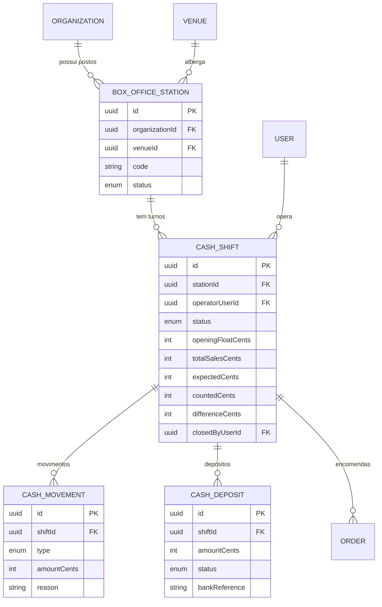

# Domínio 6 — Bilheteira Física e Gestão de Caixa

A bilheteira física é integrada ao mesmo núcleo de vendas: uma venda presencial
atualiza imediatamente o inventário central.

## MER — Domínio 6

## Estados do turno (ShiftStatus)

| Estado | Significado |
|---|---|
| OPEN | Turno em operação |
| CLOSING | Em contagem de fecho |
| CLOSED | Fechado operacionalmente (mesmo com diferença) |
| RECONCILED | Conferido e conciliado |

## Regras de negócio (doc. mestra, secção 7)

1. **Venda presencial atinge o inventário central imediatamente** — a bilheteira
   física usa o mesmo motor de encomendas (`Order.channel = BOX_OFFICE`,
   `Order.shiftId` liga a venda ao turno).
2. Turno regista: operador, abertura, fundo inicial, vendas, reembolsos,
   entradas/saídas autorizadas, valor esperado, valor contado, diferença e
   responsável pelo fecho.
3. **Fecho com diferença é permitido**: a divergência é registada
   (`differenceCents`, `differenceNotes`) e encaminhada para análise — nunca
   ignorada. Gera lançamento `CASH_DIFFERENCE` no livro-razão.
4. Movimentos de caixa não-venda (reforço de troco, entrega parcial) exigem
   motivo e autorização (`CashMovement`).
5. Ciclo do dinheiro após o fecho:

| Situação | Significado |
|---|---|
| COUNTED | Valor apurado no fecho |
| HANDED_OVER | Transferido ao responsável |
| DEPOSITED | Entregue à instituição bancária |
| CONFIRMED | Reconhecido pelo banco |

## Permissões do domínio

| Código | Descrição |
|---|---|
| `boxoffice:sell` | Vender na bilheteira física |
| `shift:open` | Abrir turno |
| `shift:close` | Fechar turno |
| `shift:reconcile` | Conciliar turno |
| `cash:movement` | Autorizar entradas/saídas de caixa |
| `cash:deposit` | Registar entregas e depósitos |
