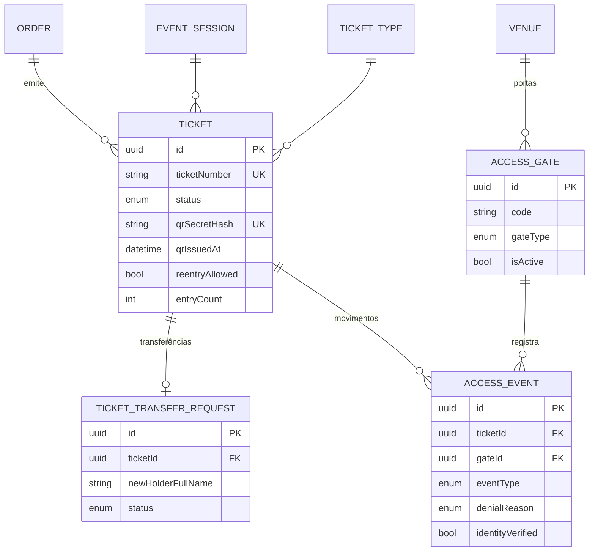

# Domínio 7 — Controlo de Acesso

Emissão e identificação de bilhetes, transferência controlada, validação de
QR Code na portaria e registo de movimentos (entrada, saída, reentrada).

## MER — Domínio 7

## Estados do bilhete (TicketStatus)

| Estado | Significado |
|---|---|
| ISSUED | Emitido, válido para entrada |
| USED | Entrada validada |
| TRANSFERRED | Titularidade transferida; QR anterior invalidado |
| CANCELLED | Cancelado (reembolso, cancelamento de evento) |
| EXPIRED | Sessão realizada sem utilização |
| REVOKED | Revogado administrativamente (fraude) |

## Emissão de bilhetes (doc. mestra, secção 14)

Cada bilhete possui: identificador único (`ticketNumber`), QR Code individual,
referência da encomenda, tipo, evento/sessão, dados do titular, estado e regras
de acesso.

Regras críticas (SEC-18):
1. **QR Codes imprevisíveis**: segredo aleatório gerado no servidor; apenas o
   **hash** é guardado (`qrSecretHash`) — o token plano nunca é persistido.
2. **Validação no servidor**: nenhuma credencial QR é válida sem confirmação
   do servidor; operação 100% online (sem aprovação offline).
3. **Emissão apenas após pagamento confirmado** (ou modalidade expressamente
   autorizada), de forma idempotente.
4. **Invalidação após transferência ou cancelamento**: rotação do segredo
   (`qrRotatedAt`) emite novo QR e invalida o anterior.

## Transferência controlada (doc. mestra, secção 13)

Fluxo: solicitação pelo titular → dados do novo titular → verificação de
elegibilidade → confirmação quando aplicável → atualização da titularidade →
invalidação do QR anterior → emissão de novo QR → registo do histórico.

**Não é permitida transferência** de bilhetes: já utilizados, cancelados,
reembolsados, sem elegibilidade ou fora dos prazos.

## Movimentos de acesso

| Evento | Descrição |
|---|---|
| ENTRY_GRANTED | Entrada validada (entryCount +1) |
| ENTRY_DENIED | Entrada recusada (com DenialReason) |
| EXIT_RECORDED | Saída registada (lastExitAt) |
| REENTRY_GRANTED | Reentrada permitida (se reentryAllowed) |
| REENTRY_DENIED | Reentrada recusada |

Motivos de recusa: INVALID_QR, ALREADY_USED, WRONG_SESSION, TICKET_CANCELLED,
TICKET_REVOKED, IDENTITY_MISMATCH, NOT_EVENT_DAY, GATE_CLOSED.

Conferência de identidade: `identityVerified` regista se o validador conferiu
a identificação do titular (obrigatória por regras do evento).

## Permissões do domínio

| Código | Descrição |
|---|---|
| `ticket:read` | Consultar bilhetes |
| `ticket:revoke` | Revogar bilhete |
| `transfer:request` | Solicitar transferência |
| `transfer:approve` | Aprovar transferência |
| `gate:manage` | Gerir portas/validadores |
| `access:validate` | Validar acessos na portaria |
| `access:report` | Consultar relatórios de acesso |
