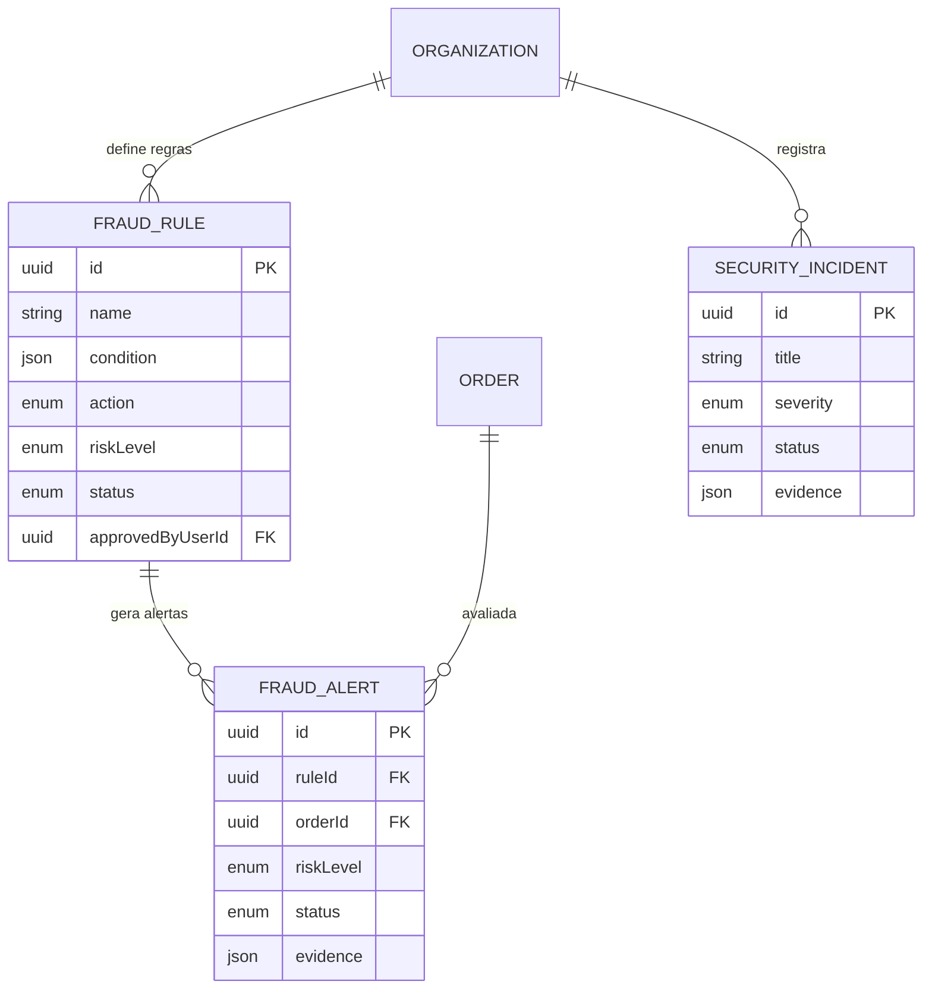

# Domínio 8 — Segurança e Antifraude

Sistema antifraude baseado em **regras explicáveis** e **controlos progressivos**
(estratégia aprovada: sem IA/ML no MVP), resposta a incidentes e auditoria.

## MER — Domínio 8

## Controlos progressivos (aprovado)

| Nível de risco | Comportamento |
|---|---|
| LOW | Permitir operação |
| MEDIUM | Exigir verificação adicional |
| HIGH | Bloquear ou encaminhar para revisão, quando justificado |

## Regras explicáveis

1. Cada `FraudRule` tem condição em JSON auditável (exemplo: valor da
   encomenda acima de limiar, número de tentativas de pagamento, velocidade de
   compra) e ação determinística: ALLOW, REQUIRE_VERIFICATION, BLOCK ou
   MANUAL_REVIEW.
2. **Alterações de regras que possam bloquear compras exigem dupla aprovação**
   (`createdByUserId` ≠ `approvedByUserId`).
3. Todo alerta guarda `evidence` (dados que dispararam a regra) — rastreável e
   contestável pelo utilizador.

## Estados do alerta

| Estado | Significado |
|---|---|
| OPEN | Alerta aberto |
| IN_INVESTIGATION | Em investigação |
| RESOLVED_FALSE_POSITIVE | Falso positivo |
| RESOLVED_CONFIRMED_FRAUD | Fraude confirmada |
| ACTION_TAKEN | Ação executada (bloqueio, cancelamento) |

## Incidentes (SEC-19)

Ciclo: DETECTED → TRIAGED → CONTAINED → INVESTIGATING → RECOVERING →
RESOLVED → CLOSED, com preservação de evidências (`evidence` em JSON),
classificação por severidade (LOW/MEDIUM/HIGH/CRITICAL), responsável pela
deteção e responsável atribuído.

## Baseline de segurança (SEC-01 a SEC-20) — mapeamento de implementação

| Controlo | Onde se aplica no sistema |
|---|---|
| SEC-01 MFA | `User.mfaEnabled`; obrigatório para perfis admin/financeiros |
| SEC-02 RBAC/ABAC | `Role`/`Permission` + guards por organização/evento/recurso |
| SEC-03 Sessões | `Session.tokenHash`, expiração e revogação |
| SEC-06 TLS | Middleware/HSTS (infraestrutura) |
| SEC-08 APIs | Idempotência em holds, pagamentos e emissão |
| SEC-09 Validação | Validação de entrada no servidor em todas as rotas |
| SEC-17 Transações | Idempotência, webhooks validados, reconciliação, ledger |
| SEC-18 Bilhetes | `qrSecretHash`, rotação em transferência, validação online |
| SEC-19 Incidentes | `SecurityIncident` com ciclo completo e evidências |
| SEC-20 Pentests | Processo operacional (antes do lançamento) |

## Permissões do domínio

| Código | Descrição |
|---|---|
| `fraudRule:create` | Criar regra (requer aprovação) |
| `fraudRule:approve` | Aprovar regra (dupla aprovação) |
| `fraudAlert:investigate` | Investigar alertas |
| `fraudAlert:resolve` | Resolver alertas |
| `incident:manage` | Gerir incidentes de segurança |
| `audit:read` | Consultar auditoria |
